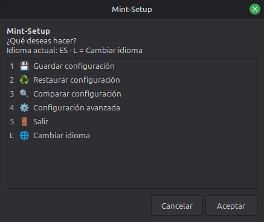
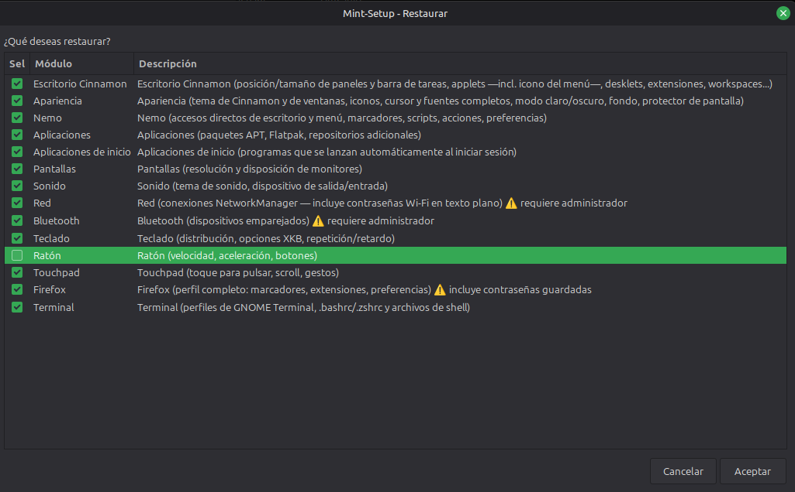
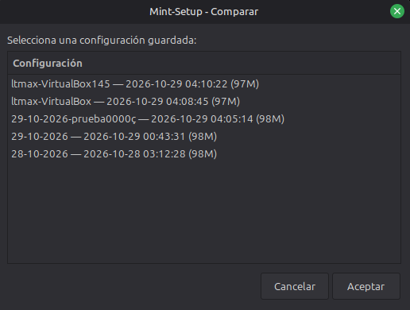
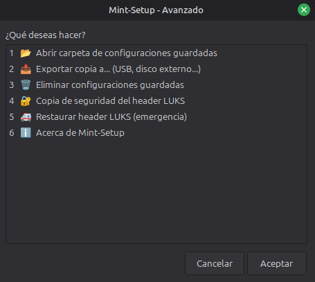

# Mint-Setup

Guarda cómo está configurado tu escritorio Cinnamon y tus aplicaciones para poder restaurar ese entorno de trabajo después de una instalación nueva de Mint.

[English](README.md) · **Español**

[](https://www.gnu.org/software/bash/) [](https://linuxmint.com/) [](LICENSE.txt)

---

## Novedades de la versión 3.1.0

- **Instalación y desinstalación por usuario.** `./mint-setup.sh --install` añade a tu usuario un acceso en el menú, un icono y el comando `mint-setup`, sin root. `--uninstall` elimina exactamente lo que se instaló y pregunta antes de tocar tus configuraciones guardadas.
- **Detección de otras distribuciones.** El script identifica la distribución, el gestor de paquetes (`apt`, `dnf`, `pacman` o `zypper`) y la sesión de escritorio, y avisa si la sesión no es Cinnamon. Fuera de APT, el módulo Aplicaciones guarda la lista de paquetes nativos instalados manualmente (`dnf` y `pacman`) y la restauración es guiada: muestra el comando que debes ejecutar en lugar de instalarlos por ti.
- **Escrituras más seguras.** Los datos guardados se publican de forma atómica; las exportaciones usan staging verificado con rollback; las restauraciones de archivos de usuario y headers LUKS conservan una copia de recuperación; y un módulo con error ya no se puede informar como restauración correcta.
- **Inglés y español en todas partes.** Menús, diálogos y mensajes de ejecución siguen tu idioma.
- **Controles de calidad automatizados.** Lint basado en ShellCheck, un ejecutor agregado de pruebas y workflows de GitHub Actions para análisis estático, compatibilidad con Ubuntu 22.04 y 24.04 y la interfaz nativa de Zenity (consulta [Tests](#tests)).

## Qué es

Mint-Setup describe cómo está configurado tu entorno de usuario en lugar de copiar todo el sistema operativo. Complementa otras herramientas de recuperación:

| Herramienta | Para qué sirve |
|---|---|
| Timeshift | Recuperación del sistema |
| MintBackup | Copia de archivos personales |
| **Mint-Setup** | Configuración del escritorio, las aplicaciones y el entorno de usuario |

Cada módulo es independiente. Guardar y Restaurar usan checklists, así que eliges exactamente qué módulos tocar.

El flujo principal es:

1. **Guardar configuración** antes de reinstalar o formatear Mint.
2. **Restaurar configuración** después de la instalación nueva.
3. **Comparar configuración** más adelante para ver cambios relevantes desde una copia guardada.

### Capturas

<p align="center">
  <br>
  <em>Menú principal: guarda, restaura y compara configuraciones, abre la configuración avanzada o cambia el idioma.</em>
</p>

<p align="center">
  <br>
  <em>Restaurar: el checklist muestra solo los módulos presentes en la configuración elegida, así que decides qué recuperar.</em>
</p>

<p align="center">
  <br>
  <em>Comparar: eliges la configuración guardada con la que contrastar el sistema actual.</em>
</p>

<p align="center">
  <br>
  <em>Configuración avanzada: las operaciones que quedan fuera del flujo normal de Guardar/Restaurar.</em>
</p>

### Módulos disponibles

Mint-Setup ofrece actualmente 20 módulos:

| Módulo | Qué guarda/restaura |
|---|---|
| Escritorio Cinnamon | Paneles y barra de tareas, applets (incluido el icono del menú), desklets, extensiones y workspaces |
| Apariencia | Temas de Cinnamon y ventanas, iconos, cursor, fuentes, modo claro/oscuro, fondo y protector de pantalla |
| Nemo | Accesos directos de escritorio y menú, marcadores, scripts, acciones y preferencias |
| Aplicaciones | Paquetes APT instalados manualmente, aplicaciones y repositorios Flatpak, repositorios APT adicionales |
| Aplicaciones de inicio | Programas que se lanzan automáticamente al iniciar sesión |
| Pantallas | Resolución y disposición de monitores |
| Sonido | Tema de sonido y dispositivo predeterminado de salida/entrada |
| Red ⚠️ | Conexiones de NetworkManager; puede contener contraseñas Wi-Fi en texto plano |
| Bluetooth ⚠️ | Dispositivos emparejados; puede contener claves de emparejamiento |
| Teclado | Distribución, opciones XKB, repetición y retardo |
| Ratón | Velocidad, aceleración y botones |
| Touchpad | Toque para pulsar, desplazamiento y gestos |
| Firefox ⚠️ | Datos del perfil nativo como marcadores, extensiones, historial y preferencias; puede incluir contraseñas guardadas |
| LibreWolf ⚠️ | Datos del perfil nativo como marcadores, extensiones, historial y preferencias; puede incluir contraseñas guardadas |
| Thunderbird ⚠️ | Cuentas, filtros, libreta de direcciones, extensiones y contraseñas de correo |
| LibreOffice | Plantillas, autocorrección, extensiones, barras de herramientas y configuración de usuario |
| ONLYOFFICE | Configuración de usuario y plugins de Desktop Editors |
| VS Code | Extensiones, settings, keybindings, snippets y perfiles con nombre |
| Docker ⚠️ parcial | Configuración de usuario, configuración del daemon y pertenencia al grupo docker; las partes del daemon/grupo necesitan permisos de administrador |
| Terminal | Perfiles de GNOME Terminal y archivos habituales de configuración de la shell |

⚠️ identifica módulos que pueden contener credenciales o datos sensibles. Red y Bluetooth necesitan permisos de administrador al guardar y restaurar. Aplicaciones necesita normalmente permisos de administrador al restaurar repositorios/paquetes APT. Docker los necesita solo para las partes del daemon y del grupo. Cada operación con privilegios pide la contraseña por separado, así que una restauración completa puede pedirla varias veces.

## Ventajas

- **Tú eliges qué tocar.** No es una imagen del sistema que se restaura de una vez: cada módulo se selecciona por separado.
- **Solo restauras lo que existe en la copia.** El checklist de Restaurar muestra los módulos presentes en la configuración elegida y la estimación de progreso pondera el trabajo realista en vez de tratar todos los módulos como iguales.
- **Puedes comparar cambios útiles.** Comparar revisa valores de apariencia guardados, fondo de pantalla, applets del panel y el conjunto de paquetes APT guardado frente al sistema actual.
- **Las credenciales se señalan.** Antes de guardar módulos sensibles, Mint-Setup avisa de qué tipos de contraseñas o claves pueden quedar incluidos.
- **Las escrituras se publican de forma segura.** Los archivos de configuración importantes pasan por staging atómico; las exportaciones se verifican antes de sustituir el destino; y las restauraciones de archivos comprimidos validan y extraen primero en staging antes de publicar cada archivo restaurado.
- **La recuperación LUKS es independiente y explícita.** Los headers de discos cifrados se gestionan desde Configuración avanzada y no se mezclan con las copias normales de configuración de usuario.

## Compatibilidad

Mint-Setup tiene como objetivo **Linux Mint 22.3 Cinnamon**. Los módulos Escritorio Cinnamon, Apariencia y Nemo dependen de la configuración propia de Cinnamon/Nemo, por lo que no se espera el mismo resultado en otro entorno de escritorio.

El script también detecta otras distribuciones y gestores de paquetes (se prueba con archivos `os-release` simulados; no se ejecutan en la CI). La CI ejecuta las suites de pruebas en contenedores limpios de Ubuntu 22.04 y 24.04 (las bases de Linux Mint 21 y 22), y el workflow nativo de Zenity cubre Ubuntu 24.04. Estas comprobaciones no se ejecutan dentro de una sesión de escritorio Mint: la integración específica de Mint aún requiere un entorno real con Linux Mint 22.3.

**Bash:** 4.4 o superior. El programa lo comprueba antes que nada y se detiene con un mensaje en una versión anterior: con `set -u`, bash 4.3 trata un array vacío como no definido y abortaría a mitad de un guardado o una restauración. La CI ejecuta bash 5.1 (Ubuntu 22.04) y 5.2 (Ubuntu 24.04).

**Comandos obligatorios:** `zenity`, `dconf`, `gsettings`, `tar`. El script los comprueba antes de iniciar el flujo normal de la interfaz gráfica.

**Comandos opcionales:**

| Comando | Para qué sirve |
|---|---|
| `apt-get` / `apt-mark` | Paquetes y repositorios APT (sistemas basados en Debian) |
| `dnf` / `pacman` | Guardar la lista de paquetes nativos instalados manualmente en esos sistemas |
| `flatpak` | Aplicaciones y repositorios Flatpak |
| `pkexec` | Operaciones que requieren permisos de administrador |
| `pactl` | Dispositivo de salida/entrada de sonido predeterminado |
| `iconv` | Gestión más fiable de nombres de copia con tildes o `ñ` |
| `gio` | Marcar como de confianza los lanzadores restaurados del Escritorio |
| `fc-cache` | Actualizar la caché de fuentes después de restaurarlas |
| `xdg-user-dir` | Resolver carpetas de usuario como Escritorio o Imágenes |
| `pgrep` | Comprobar si siguen abiertos navegadores, correo u Office |
| `code` / `code-insiders` | Guardar y restaurar la lista de extensiones de VS Code |
| `cryptsetup` | Copia de seguridad y restauración de emergencia de headers LUKS |

La falta de un comando opcional solo afecta al paso que lo utiliza; no hace que el programa entero deje de estar disponible.

## Instalación

No hay compilación ni paquete. Ejecuta el script directamente desde un clon o instálalo para tu usuario. En ambos casos, ejecútalo como tu usuario normal de escritorio:

```bash
git clone https://github.com/filonux/mint-setup.git
cd mint-setup/script
chmod +x mint-setup.sh
./mint-setup.sh              # ejecutar desde el clon
./mint-setup.sh --install    # o: instalar para tu usuario (menú, icono, comando)
```

`--install` copia el script a `~/.local/bin/mint-setup`, crea en tu menú de aplicaciones un lanzador con su icono y anota todo en `~/.local/share/mint-setup/install.manifest`. Nunca sobrescribe un archivo que no sea de Mint-Setup. Si `~/.local/bin` no está en tu `PATH`, el lanzador del menú funciona enseguida y el comando `mint-setup` funciona después de cerrar la sesión y volver a entrar.

También puedes lanzar el script desde Nemo después de activar su permiso de ejecución en **Propiedades → Permisos**.

**No** ejecutes el script completo con `sudo` ni como root: se niega a arrancar. Las operaciones que necesitan permisos de administrador los solicitan por separado mediante PolicyKit.

## Comandos

| Comando | Efecto |
|---|---|
| `./mint-setup.sh` | Abre el menú principal |
| `./mint-setup.sh --version` | Muestra la versión actual del script y termina |
| `./mint-setup.sh --help` (`-h`) | Muestra las opciones disponibles |
| `./mint-setup.sh --install` | Instala para tu usuario: acceso en el menú, icono y comando `mint-setup` |
| `./mint-setup.sh --uninstall` | Desinstala; pregunta si conservar tus preferencias y configuraciones guardadas |
| `./mint-setup.sh --toggle-language` | Cambia entre inglés/español, guarda la elección y continúa |
| `./mint-setup.sh -l` | Igual que `--toggle-language` |
| `--yes` (`-y`), `--keep-config`, `--purge` | Opciones de `--uninstall`; consulta [Desinstalación](#desinstalación) |
| `MINT_SETUP_BACKUPS_DIR=/ruta ./mint-setup.sh` | Usa `/ruta` para las configuraciones guardadas en lugar de `~/MintSetupBackups` |

## Cómo se usa

**💾 Antes de reinstalar o formatear**, abre Mint-Setup, elige **Guardar configuración**, selecciona los módulos que quieras y ponle un nombre a la configuración. Si vas a formatear todo el disco, exporta antes la copia terminada a un almacenamiento externo.

**♻️ Después de una instalación nueva**, elige **Restaurar configuración**, selecciona una configuración guardada y marca los módulos que quieras recuperar. Grandes conjuntos de aplicaciones, extensiones de VS Code y perfiles de navegador/correo pueden tardar más. Algunos cambios solo serán visibles después de reiniciar la aplicación afectada, cerrar sesión o reiniciar Cinnamon.

**🔍 Cuando quieras revisar cambios**, elige **Comparar configuración**. La comparación actual cubre determinados valores de apariencia, fondo de pantalla, applets del panel y el conjunto guardado de paquetes APT.

## Configuración avanzada

Configuración avanzada reúne las operaciones que no forman parte del flujo normal de Guardar/Restaurar:

| Acción | Qué hace |
|---|---|
| Abrir carpeta de configuraciones guardadas | Abre la carpeta de copias en el gestor de archivos |
| Exportar copia a... | Copia una configuración elegida a otro directorio, dejando intacta la original; prepara y verifica el destino antes de sustituir una copia existente |
| Eliminar configuraciones guardadas | Elimina de forma permanente las configuraciones seleccionadas |
| Copia de seguridad del header LUKS | Crea una copia binaria de emergencia del header de un disco cifrado detectado y, cuando es posible, una nota separada con sus metadatos |
| Restaurar header LUKS | Operación de emergencia para un header dañado; comprueba UUID, exige una confirmación explícita y conserva una copia de recuperación mientras la verificación/rollback siga siendo posible |
| Acerca de Mint-Setup | Muestra la versión, el autor y la ubicación de las copias |

Por defecto, las configuraciones guardadas están en `~/MintSetupBackups`. La preferencia de idioma se guarda aparte en `$XDG_CONFIG_HOME/mint-setup/language` o en `~/.config/mint-setup/language` cuando `XDG_CONFIG_HOME` no está definida.

Las copias de headers LUKS viven en el directorio independiente `LuksHeaders`. La acción normal **Exportar copia a...** solo maneja configuraciones guardadas; no exporta ese directorio LUKS.

### Privacidad y seguridad

Las copias se crean con permisos restrictivos (`700` para el árbol de copias y `600` para archivos sensibles) porque varios módulos pueden contener credenciales. Los datos de contraseñas de navegadores/correo pueden estar protegidos por el propio cifrado del perfil de la aplicación, según cómo esté configurada; la copia de seguridad en sí no añade una capa de cifrado.

Al exportar a sistemas de archivos como FAT32/exFAT, pueden no existir controles de permisos Unix. El script avisa cuando la copia contiene módulos sensibles. Cualquiera que pueda leer los archivos exportados podría leer también esas credenciales.

## Desinstalación

Si instalaste con `--install`, ejecuta:

```bash
mint-setup --uninstall
```

Elimina exactamente lo que anotó el instalador (comando, lanzador, icono y manifest) y conserva cualquiera de esos archivos que hayas modificado tú. Después pregunta si quieres conservar tus preferencias y configuraciones guardadas; por defecto se conservan. Opciones:

| Opción | Efecto |
|---|---|
| `--yes`, `-y` | No pregunta; se conservan tus preferencias y configuraciones guardadas |
| `--keep-config` | Conserva tus preferencias y configuraciones guardadas |
| `--purge` | Borra también tus preferencias, configuraciones guardadas y copias de recuperación; es permanente |

`--purge` y `--keep-config` no se pueden combinar, ni tampoco `--install` y `--uninstall`; una línea así se rechaza con código de salida 2 y no hace nada. Sin `--yes`, el comando es interactivo y termina con error si no puede preguntarte. `--purge` borra las configuraciones guardadas en `~/MintSetupBackups` (o en el directorio de `MINT_SETUP_BACKUPS_DIR`), pero no el directorio `LuksHeaders`; si contiene copias de headers, el mensaje final indica que se conservan y da su ruta.

Si solo ejecutaste el script desde un clon, no hay nada que desinstalar: elimina el directorio clonado.

## Scriptya

`--install` ya crea un acceso en el menú. Si prefieres envolver el script de otra forma, [**Scriptya**](https://github.com/filonux/Scriptya), otra herramienta del mismo autor, convierte un script en una aplicación independiente con su propio icono e integración en el menú.

Un lanzador creado con Scriptya se elimina desde Scriptya, no con `--uninstall`.

## Idioma y roadmap

Mint-Setup tiene mensajes, menús y diálogos en inglés y español. Los comentarios del código están escritos en inglés.

En la primera ejecución, el script evalúa `LC_ALL`, `LC_MESSAGES`, `LANGUAGE` y `LANG` en ese orden. Un locale efectivo en español inicia la interfaz en español; en cualquier otro caso se usa inglés.

Puedes cambiar el idioma desde el menú principal con **L**, o desde la terminal con `./mint-setup.sh -l` o `./mint-setup.sh --toggle-language`. La elección explícita se guarda aparte de las copias y tiene prioridad sobre la detección automática del locale en ejecuciones posteriores. Cambiar de idioma no modifica identificadores de módulos, rutas ni formatos de las copias.

El roadmap público se mantiene deliberadamente pequeño: ampliar la verificación a más versiones de Mint/entornos de escritorio y, a largo plazo, ofrecer un formato de paquete nativo como `.deb`.

## Tests

El repositorio contiene suites de pruebas shell independientes y un control de análisis estático:

| Prueba | Cobertura |
|---|---|
| `tests/test-localization.sh` | Localización, cobertura del catálogo, comportamiento CLI de idioma/versión e invariantes del formato de copias |
| `tests/test-language-invariance.sh` | Invariancia semántica inglés/español y regresiones de escritura atómica |
| `tests/test-module-invariance.sh` | Invariancia de módulos de Guardar/Restaurar entre idiomas |
| `tests/test-privileged-invariance.sh` | Invariancia de trazas de comandos privilegiados/sistema entre idiomas |
| `tests/test-ui.sh` | Estructura de menús/checklists Zenity y seguridad del texto visual |
| `tests/test-user-flow.sh` | Flujo Guardar/Restaurar, propagación de fallos, exportaciones, publicación atómica y rollback LUKS |
| `tests/test-compat.sh` | Detección de distribución y gestor de paquetes con sistemas simulados |
| `tests/test-install.sh` | `--install` y `--uninstall`, incluido no dejar rastro tras `--purge` |
| `tests/test-robustness.sh` | Casos límite de formato de texto, nombres hostiles, cancelaciones, datos dañados e interrupciones |
| `tests/test-security.sh` | Protecciones de seguridad: sin `eval`, `sudo` ni rutas temporales fijas, `umask 077`, modos de archivo, rechazo de root |
| `tests/test-native-zenity.sh` | Zenity real bajo Xvfb (inglés y español); SKIP si faltan Zenity o sus herramientas auxiliares |
| `tests/test-runner.sh` | El propio lanzador (`run.sh`): recuento de PASS/SKIP/FAIL, `--only`, `--skip` y `TEST_STRICT` |

Ejecuta todo, o una sola suite:

```bash
LINT_STRICT=1 bash tests/lint.sh         # bash -n, ShellCheck 0.11.0, higiene y modos de archivos, YAML
bash tests/run.sh                         # todas las suites, con resumen y código de salida
bash tests/run.sh --only user-flow        # una suite; --list las muestra todas
bash tests/run.sh --skip native-zenity    # omite la suite gráfica
```

`run.sh` da a cada suite un `HOME` aislado y ninguna sesión gráfica ni de D-Bus, así que las pruebas nunca tocan tu entorno real. Una suite termina con `0` si pasa, `77` si se omite (SKIP) y cualquier otro valor si falla. Con `TEST_STRICT=1`, un SKIP (una suite que termina con `77`, o que imprime líneas `SKIP`) cuenta como fallo, así que ninguna comprobación se omite en silencio.

La suite nativa puede usar un contenedor local con `bash tests/test-native-zenity.sh --container` cuando haya Docker o Podman. GitHub Actions ejecuta `lint.sh` y las suites (`quality.yml`), las suites en Ubuntu 22.04 y 24.04 (`compat.yml`) y la suite gráfica nativa (`native-zenity.yml`), y guarda las capturas y la geometría de ventanas nativas como artefactos de CI.

## Contribuir

Los issues y pull requests son bienvenidos. Empieza por [CONTRIBUTING.md](.github/CONTRIBUTING.md) y consulta el [Código de Conducta](.github/CODE_OF_CONDUCT.md) y la [política de seguridad](.github/SECURITY.md) cuando corresponda. Esos documentos están en inglés. Ejecuta `LINT_STRICT=1 bash tests/lint.sh` y `bash tests/run.sh` antes de abrir un pull request. Las plantillas de reporte de error, solicitud de función y consulta están en `.github/ISSUE_TEMPLATE/`.

## Licencia

Mint-Setup se distribuye bajo **GPLv3**. Consulta [LICENSE.txt](LICENSE.txt).

---

Hecho por **[Filonux](https://github.com/filonux)**.
