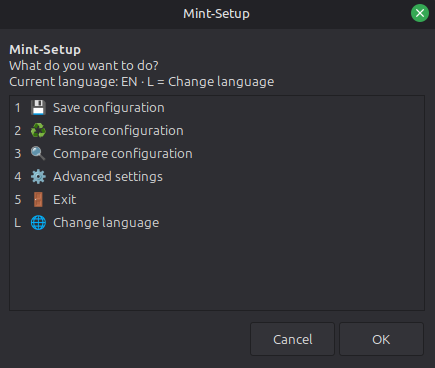
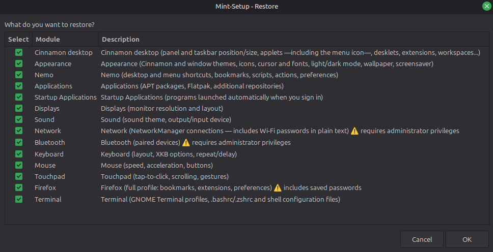
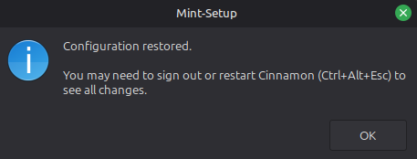
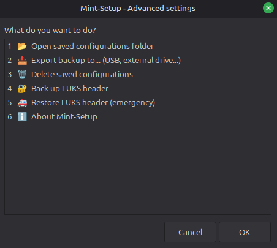
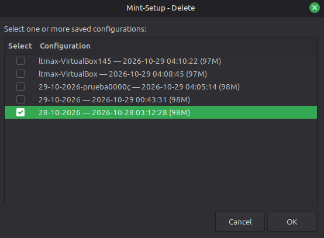

# Mint-Setup

Save how your Cinnamon desktop and applications are configured, then restore that working environment after a fresh Mint installation.

[**English**](README.md) · [Español](README-es.md)

[](https://www.gnu.org/software/bash/) [](https://linuxmint.com/) [](LICENSE.txt)

---

## What's new in 3.1.0

- **Per-user install and uninstall.** `./mint-setup.sh --install` adds a menu launcher, an icon and a `mint-setup` command for your user, without root. `--uninstall` removes exactly what was installed and asks before touching your saved configurations.
- **Other distributions are detected.** The script identifies the distribution, the package manager (`apt`, `dnf`, `pacman` or `zypper`) and the desktop session, and warns when the session is not Cinnamon. Outside APT, the Applications module saves the list of manually installed native packages (`dnf` and `pacman`) and the restore is guided: it shows the command to run instead of installing them for you.
- **Safer writes.** Saved data is published atomically; exports are staged and verified with rollback; restores of user files and LUKS headers keep a recovery copy; and a failing module can no longer be reported as a successful restore.
- **English and Spanish everywhere.** Menus, dialogs and runtime messages follow your language.
- **Automated quality gates.** ShellCheck-based linting, an aggregate test runner and GitHub Actions workflows for static analysis, Ubuntu 22.04/24.04 compatibility and the native Zenity GUI (see [Tests](#tests)).

## What it is

Mint-Setup describes how your user environment is configured instead of copying the whole operating system. It complements other recovery tools:

| Tool | Purpose |
|---|---|
| Timeshift | System recovery |
| MintBackup | Personal-file backup |
| **Mint-Setup** | Desktop, application and user-environment configuration |

Each module is independent. Save and Restore both use checklists, so you choose exactly which modules to touch.

The main flow is:

1. **Save configuration** before reinstalling or formatting Mint.
2. **Restore configuration** after the fresh installation.
3. **Compare configuration** later to see relevant changes since a saved backup.

### Screenshots

<p align="center">
  <br>
  <em>Main menu: save, restore and compare configurations, open the advanced settings or change the language.</em>
</p>

<p align="center">
  <br>
  <em>Restore: the checklist shows only the modules present in the chosen configuration, so you decide what to recover.</em>
</p>

<p align="center">
  <br>
  <em>Restore finished: you may need to sign out or restart Cinnamon (Ctrl+Alt+Esc) to see every change.</em>
</p>

<p align="center">
  <br>
  <em>Advanced settings: the operations outside the normal Save/Restore flow.</em>
</p>

<p align="center">
  <br>
  <em>Delete: tick the saved configurations you want to remove.</em>
</p>

### Available modules

Mint-Setup currently exposes 20 modules:

| Module | What it saves/restores |
|---|---|
| Cinnamon Desktop | Panels and taskbar, applets (including the menu icon), desklets, extensions and workspaces |
| Appearance | Cinnamon and window themes, icons, cursor, fonts, light/dark mode, wallpaper and screensaver |
| Nemo | Desktop and menu shortcuts, bookmarks, scripts, actions and preferences |
| Applications | Manually installed APT packages, Flatpak applications and repositories, additional APT repositories |
| Startup Applications | Programs launched automatically at login |
| Displays | Monitor resolution and layout |
| Sound | Sound theme and default output/input device |
| Network ⚠️ | NetworkManager connections; may contain Wi-Fi passwords in plain text |
| Bluetooth ⚠️ | Paired devices; may contain pairing keys |
| Keyboard | Layout, XKB options, repeat rate and delay |
| Mouse | Speed, acceleration and buttons |
| Touchpad | Tap-to-click, scrolling and gestures |
| Firefox ⚠️ | Native profile data such as bookmarks, extensions, history and preferences; may include saved passwords |
| LibreWolf ⚠️ | Native profile data such as bookmarks, extensions, history and preferences; may include saved passwords |
| Thunderbird ⚠️ | Accounts, filters, address book, extensions and mail passwords |
| LibreOffice | Templates, autocorrect, extensions, toolbars and user configuration |
| ONLYOFFICE | User configuration and Desktop Editors plugins |
| VS Code | Extensions, settings, keybindings, snippets and named profiles |
| Docker ⚠️ partial | User configuration, daemon configuration and docker-group membership; the daemon/group parts need administrator privileges |
| Terminal | GNOME Terminal profiles and common shell configuration files |

⚠️ identifies modules that can contain credentials or sensitive data. Network and Bluetooth require administrator privileges when saving and restoring. Applications normally needs administrator privileges while restoring APT repositories/packages. Docker needs them only for its daemon/group parts. Every privileged operation asks for the password separately, so a full restore may ask for it several times.

## Advantages

- **You choose what to touch.** Nothing is an all-or-nothing system image: every module is selected independently.
- **You restore only what is in the backup.** The Restore checklist lists the modules actually present in the selected configuration, and its progress estimate is weighted by realistic work rather than treating every module as equal.
- **You get a useful comparison.** Compare checks saved appearance values, the wallpaper, panel applets and the saved APT package set against the current system.
- **Credentials are not hidden.** Before saving sensitive modules, Mint-Setup warns which kinds of passwords or keys may be included.
- **Writes are published safely.** Important configuration files are written through atomic staging; exports are verified before replacement; archive restores validate and extract into staging before publishing restored files one by one.
- **LUKS recovery is separate and explicit.** Encrypted-disk headers are handled from Advanced settings rather than mixed into ordinary user-configuration backups.

## Compatibility

Mint-Setup targets **Linux Mint 22.3 Cinnamon**. The Cinnamon Desktop, Appearance and Nemo modules depend on Cinnamon/Nemo-specific configuration, so they are not expected to provide the same result in another desktop environment.

The script also detects other distributions and package managers (tested with simulated `os-release` files, not run in CI). CI runs the test suites in clean Ubuntu 22.04 and 24.04 containers (the Linux Mint 21 and 22 bases), and the native Zenity workflow covers Ubuntu 24.04. These checks do not run inside a Mint desktop session: Mint-specific integration still needs a real Linux Mint 22.3 environment.

**Bash:** 4.4 or newer. The program checks this before anything else and stops with a message on an older bash: with `set -u`, bash 4.3 treats an empty array as unset and would abort a save or restore halfway. CI runs bash 5.1 (Ubuntu 22.04) and 5.2 (Ubuntu 24.04).

**Mandatory commands:** `zenity`, `dconf`, `gsettings`, `tar`. The script checks these before starting the normal GUI flow.

**Optional commands:**

| Command | Purpose |
|---|---|
| `apt-get` / `apt-mark` | APT packages and repositories (Debian-based systems) |
| `dnf` / `pacman` | Save the list of manually installed native packages on those systems |
| `flatpak` | Flatpak applications and remotes |
| `pkexec` | Administrator-only restore/save operations |
| `pactl` | Default sound output/input |
| `iconv` | More reliable handling of backup names containing accents or `ñ` |
| `gio` | Mark restored desktop launchers as trusted |
| `fc-cache` | Refresh the font cache after restoring fonts |
| `xdg-user-dir` | Resolve user directories such as Desktop and Pictures |
| `pgrep` | Check whether browser/mail/office applications are still open |
| `code` / `code-insiders` | Save and restore VS Code extension lists |
| `cryptsetup` | LUKS header backup and emergency restoration |

Missing optional commands only affect the step that uses them; they do not make the whole program unavailable.

## Installation

There is no build step and no package. Run the script straight from a clone, or install it for your user. Either way, run it as your normal desktop user:

```bash
git clone https://github.com/filonux/mint-setup.git
cd mint-setup/script
chmod +x mint-setup.sh
./mint-setup.sh              # run from the clone
./mint-setup.sh --install    # or: install for your user (menu entry, icon, command)
```

`--install` copies the script to `~/.local/bin/mint-setup`, creates a launcher with its icon in your applications menu, and records everything in `~/.local/share/mint-setup/install.manifest`. It never overwrites a file that does not belong to Mint-Setup. If `~/.local/bin` is not in your `PATH`, the menu launcher works right away and the `mint-setup` command works after you log out and back in.

You can also launch the script from Nemo after enabling its execution permission in **Properties → Permissions**.

Do **not** run the whole script with `sudo` or as root: it refuses to start. Operations that need administrator privileges request them separately through PolicyKit.

## Commands

| Command | Effect |
|---|---|
| `./mint-setup.sh` | Open the main menu |
| `./mint-setup.sh --version` | Print the current script version and exit |
| `./mint-setup.sh --help` (`-h`) | Show the available options |
| `./mint-setup.sh --install` | Install for your user: menu entry, icon and `mint-setup` command |
| `./mint-setup.sh --uninstall` | Uninstall; asks whether to keep your preferences and saved configurations |
| `./mint-setup.sh --toggle-language` | Toggle English/Spanish, save the choice, then continue |
| `./mint-setup.sh -l` | Same language toggle as `--toggle-language` |
| `--yes` (`-y`), `--keep-config`, `--purge` | Options for `--uninstall`; see [Uninstall](#uninstall) |
| `MINT_SETUP_BACKUPS_DIR=/path ./mint-setup.sh` | Use `/path` for saved configurations instead of `~/MintSetupBackups` |

## How to use

**💾 Before reinstalling or formatting**, open Mint-Setup, choose **Save configuration**, select the modules you want, and give the configuration a name. If you are formatting the whole disk, export the finished backup to external storage before doing so.

**♻️ After a fresh installation**, choose **Restore configuration**, select a saved configuration, and select the modules you want to restore. Large application sets, VS Code extensions and browser/mail profiles can take longer. Some changes become visible only after restarting an affected application, logging out, or restarting Cinnamon.

**🔍 When you need to audit drift**, choose **Compare configuration**. The current comparison covers selected appearance values, wallpaper, panel applets and the saved APT package set.

## Advanced settings

Advanced settings contains the operations that do not belong to the normal Save/Restore flow:

| Action | What it does |
|---|---|
| Open saved configurations folder | Opens the backup directory in the file manager |
| Export backup to... | Copies a selected configuration to another directory, keeping the original backup untouched; the destination is staged and verified before it replaces an existing copy |
| Delete saved configurations | Permanently deletes the selected saved configurations |
| Back up a LUKS header | Creates a binary emergency backup of a detected encrypted-disk header and a separate metadata note when possible |
| Restore a LUKS header | Emergency operation for a damaged header; checks UUIDs, requests explicit confirmation, and keeps a recovery copy while verification/rollback is still possible |
| About Mint-Setup | Shows the program version, author and backup location |

By default, saved configurations live in `~/MintSetupBackups`. A language preference lives separately in `$XDG_CONFIG_HOME/mint-setup/language`, or `~/.config/mint-setup/language` when `XDG_CONFIG_HOME` is not set.

LUKS header backups live in the separate `LuksHeaders` directory. The normal **Export backup to...** action only handles saved configurations; it does not export that LUKS directory.

### Privacy and security

Backups are created with restrictive permissions (`700` for the backup tree, `600` for sensitive files) because several modules may contain credentials. Browser/mail password data may be protected by the application's own profile encryption, depending on how that application is configured; the backup itself is not an encryption layer.

When you export to filesystems such as FAT32/exFAT, Unix permission controls may not be available. The script warns about this when the selected backup contains sensitive modules. Anyone who can read the exported files can potentially read those credentials.

## Uninstall

If you installed with `--install`, run:

```bash
mint-setup --uninstall
```

It removes exactly what the installer recorded (command, launcher, icon and manifest) and keeps any of those files you modified yourself. It then asks whether to keep your preferences and saved configurations; the default is to keep them. Options:

| Option | Effect |
|---|---|
| `--yes`, `-y` | Do not ask; your preferences and saved configurations are kept |
| `--keep-config` | Keep your preferences and saved configurations |
| `--purge` | Also delete your preferences, saved configurations and recovery copies; this is permanent |

`--purge` and `--keep-config` cannot be combined, nor can `--install` and `--uninstall`; such a command line is rejected with exit code 2 and does nothing. Without `--yes`, the command is interactive and exits with an error if it cannot ask you. `--purge` deletes saved configurations in `~/MintSetupBackups` (or the `MINT_SETUP_BACKUPS_DIR` directory) but not the `LuksHeaders` directory; if it holds header copies, the closing message says they were kept and gives its path.

If you only ran the script from a clone, there is nothing to uninstall: delete the cloned directory.

## Scriptya

`--install` already creates a menu entry. If you prefer to wrap the script differently, [**Scriptya**](https://github.com/filonux/Scriptya), another tool by the same author, turns a script into a standalone application with its own icon and menu integration.

A launcher created with Scriptya is removed through Scriptya, not with `--uninstall`.

## Language and roadmap

Mint-Setup has English and Spanish runtime messages, menus and dialogs. Code comments are written in English.

On first run, the script evaluates `LC_ALL`, `LC_MESSAGES`, `LANGUAGE` and `LANG` in that order. An effective Spanish locale starts the interface in Spanish; otherwise English is used.

You can switch languages from the main menu with **L**, or from the terminal with `./mint-setup.sh -l` or `./mint-setup.sh --toggle-language`. The explicit choice is stored separately from backups and takes priority over later automatic locale detection. Changing language does not change module identifiers, paths or backup formats.

The public roadmap is intentionally small: broaden verification across more Mint releases/desktops and eventually provide a native package format such as `.deb`.

## Tests

The repository contains independent shell test suites plus a static-analysis gate:

| Test | Coverage |
|---|---|
| `tests/test-localization.sh` | Localization, catalog coverage, CLI language/version behavior, backup-format invariants |
| `tests/test-language-invariance.sh` | English/Spanish semantic invariance and atomic-write regressions |
| `tests/test-module-invariance.sh` | Save/restore module invariance between languages |
| `tests/test-privileged-invariance.sh` | Privileged/system command traces between languages |
| `tests/test-ui.sh` | Zenity menu/checklist structure and visual-text safety |
| `tests/test-user-flow.sh` | Save/restore flow, failure propagation, exports, atomic publication and LUKS rollback |
| `tests/test-compat.sh` | Distribution and package-manager detection with simulated systems |
| `tests/test-install.sh` | `--install` and `--uninstall`, including leaving no trace after `--purge` |
| `tests/test-robustness.sh` | Text formatting edge cases, hostile names, cancellations, damaged data, interruptions |
| `tests/test-security.sh` | Hardening guards: no `eval`, `sudo` or fixed temp paths, `umask 077`, file modes, root refusal |
| `tests/test-native-zenity.sh` | Real Zenity under Xvfb (English and Spanish); SKIP when Zenity or its helper tools are missing |
| `tests/test-runner.sh` | The runner itself (`run.sh`): PASS/SKIP/FAIL accounting, `--only`, `--skip` and `TEST_STRICT` |

Run everything, or one suite:

```bash
LINT_STRICT=1 bash tests/lint.sh         # bash -n, ShellCheck 0.11.0, file hygiene and modes, YAML
bash tests/run.sh                         # every suite, with a summary and an exit code
bash tests/run.sh --only user-flow        # one suite; --list shows them all
bash tests/run.sh --skip native-zenity    # skip the GUI suite
```

`run.sh` gives each suite an isolated `HOME` and no display or D-Bus session, so tests never touch your real environment. A suite exits `0` on PASS, `77` on SKIP and anything else on FAIL. With `TEST_STRICT=1` a SKIP (a suite that exits `77`, or one that prints `SKIP` lines) counts as a failure, so no check is silently left out.

The native suite can use a local container with `bash tests/test-native-zenity.sh --container` when Docker or Podman is available. GitHub Actions runs `lint.sh` and the suites (`quality.yml`), the suites on Ubuntu 22.04 and 24.04 (`compat.yml`) and the native GUI suite (`native-zenity.yml`), and stores the native screenshots and window geometry as CI artifacts.

## Contributing

Issues and pull requests are welcome. Start with [CONTRIBUTING.md](.github/CONTRIBUTING.md), and review the project's [Code of Conduct](.github/CODE_OF_CONDUCT.md) and [security policy](.github/SECURITY.md) when relevant. Run `LINT_STRICT=1 bash tests/lint.sh` and `bash tests/run.sh` before opening a pull request. Bug report, feature request and question templates are available under `.github/ISSUE_TEMPLATE/`.

## License

Mint-Setup is distributed under **GPLv3**. See [LICENSE.txt](LICENSE.txt).

---

Made by **[Filonux](https://github.com/filonux)**.
